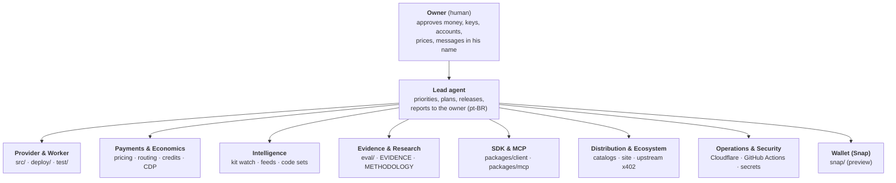

# AGENTS.md — x402check operating map

This is the map that every AI agent working on x402check reads first: Claude Code, Codex, Cursor or any other. It says:
- who owns what (the org chart);
- where everything lives;
- what to do when something happens;
- what is never allowed.

`CLAUDE.md` imports this file.

**Keep it current.** If you add or change an endpoint, a secret, a workflow, a catalog listing, a runbook or an owner, update this file in the same commit.

---

## 0. The product in one paragraph

**x402check** (`https://x402check.xyz`, `did:web:x402check.xyz`) is an x402 `risk-check` provider. Before an AI agent or a wallet pays, it checks the counterparty:
- the OFAC SDN list;
- phishing and drainer feeds;
- **its own kit watch** of drainer infrastructure on Ethereum and Base;
- transaction simulation;
- drainer-kit code;
- injected instructions in the content the agent acted on.

Every verdict is an ES256 attestation that states which checks ran. **Every check is paid; there is no free tier.**
- **Prepaid credits:** $0.001 a check.
- **Per call via x402:** priced by network, from $0.001 ($0.0035 on Base).
- **Simulated transaction:** $0.005.

The service runs as one Cloudflare Worker. The repository is `caiovicentino/jev-risk-check-provider` (MIT).

---

## 1. Org chart



One agent may hold several roles in one session. Know which lane you are working in, and respect its "done means".

| Role | Owns | Does | When | Done means |
|---|---|---|---|---|
| **Owner** (human) | Accounts: Cloudflare, npm org `x402check`, Coinbase CDP, GitHub, domain. Funds and keys. | Approves anything in §4 "Needs the owner". Creates keys and accounts, and signs 2FA with a macOS passkey. | On request. | He said yes, in chat. |
| **Lead agent** | Direction (`docs/STRATEGY.md`), releases (`CHANGELOG.md`, tags, GitHub releases), this file. | Sets priorities, splits work across the roles, verifies, and reports to the owner in **Brazilian Portuguese with correct accents**. | Every session. | Work verified in production, docs updated, the owner told plainly what changed and what is pending. |
| **Provider & Worker** | `src/` (provider core, scoring, landing, validation), `deploy/` (Worker, paid flow), `test/`. | Builds the API and the site. | Any code change. | All suites green (§3.1), deployed, `/healthz` shows the new version. |
| **Payments & Economics** | `deploy/pricing.ts`, the routing in `deploy/protected.ts`, `deploy/credits.ts`, `deploy/cdp.ts`. | Maintains prices, facilitator routing (CDP, PayAI, Dexter) and prepaid credits. Watches margins. | Fee changes, facilitator incidents, pricing work. | `/status` → `payments` shows every offered route's margin above 0 (a network whose every route would lose money shows `offered: false` and is not in the 402 challenge), and `facilitators` are all ok. |
| **Intelligence** | Kit watch (`src/kit-watch*.ts`, `deploy/kit-watch.ts`, the per-minute cron), feeds (`scripts/update-*.ts`, `scripts/publish-feeds.ts`, `scripts/feeds-guard.mjs`, `.github/workflows/feeds.yml`, `deploy/scamsniffer-refresh.ts`, `src/never-flag.ts`), code sets (`scripts/kit-*.ts`, `hunt-kits.ts`, `legit-corpus.ts`). | Owns detection data: our own watch, lists and fingerprints. | The cron runs every minute and feeds refresh daily; also on new threat intel. | `/status` → `kit_watch` is `ok`, with lag 0, `gaps` not growing, `unbroken_since` not moving and `pending_reads` near 0. Every code set passed the collision gate. |
| **Evidence & Research** | `eval/`, `eval/evidence/*-report.json`, `docs/EVIDENCE.md`, `docs/METHODOLOGY.md`. | Measures, and publishes negative results too. Runs the paid production probes. | Every release that changes behaviour, and every public claim. | Numbers reproducible from the report, with Wilson CIs and externally grounded labels. |
| **SDK & MCP** | `packages/client` (`@x402check/client`, including the signing guard), `packages/mcp` (`@x402check/mcp`), the framework integrations `packages/ai-sdk` (`@x402check/ai-sdk`) and `packages/agentkit` (`@x402check/agentkit`), `packages/mcp/server.json`, `scripts/publish-npm.sh`, `scripts/sync-decoders.mjs`. | Typed client, attestation verifier, **signing guard**, and the MCP server for agents. | API changes that affect clients, and releases. | Published on npm, installable with `npx`, and listed in the MCP Registry. |
| **Distribution & Ecosystem** | Catalog listings (§2.5), `deploy/discovery.ts` (Bazaar declaration, `/openapi.json`), `src/landing.ts`, `README.md`, upstream threads (§2.6), `docs/DISTRIBUTION.md` (drafts). | Keeps x402check wherever agents and their developers look. | After discovery-affecting changes, and weekly. | Each catalog shows current prices and endpoints (§3.5). |
| **Operations & Security** | Cloudflare (Worker `x402check`, KV `RATE`, Durable Object `CREDITS`, cron, secrets, analytics), GitHub Actions (`ci.yml`, `feeds.yml`, `publish-mcp-registry.yml`). | Deploys, monitors, responds to incidents, keeps secrets hygienic. | Every deploy and incident, and on anomalies. | Production healthy, and no secret in any output, log, commit or report. |
| **Wallet (Snap)** | `snap/` (MetaMask Snap 0.3.0). | Decodes locally and sends nothing. It is not published and not allowlisted, and it cannot pay yet. | Wallet work only. | `npm --prefix snap test` green. |

---

## 2. Where things are

### 2.1 Repository

| Path | What |
|---|---|
| `src/` | Provider core: `provider.ts` (evaluation and `PROVIDER_VERSION`), `scoring.ts`, `validate.ts`, `handler.ts` (routes the Worker does not special-case), `landing.ts` (the site and `og.png`), `jws.ts` (attestations, `request_hash`), `simulation.ts`, `kit-watch*.ts`, `sanctions.ts`, `domain-analysis.ts`, `icon.ts`, `never-flag.ts` (addresses no community list may flag: our `pay_to`, Permit2 and x402's proxies, the asset x402 charges in per network, major tokens), `data/` (embedded OFAC and MetaMask sets) |
| `deploy/` | Cloudflare Worker. `worker.ts` (routing, `/status`, cron, HEAD handling), `protected.ts` (paid flow, routing, stack, attestation-key check), `payment-claims.ts` (single use of each payment), `http-util.ts` (payer screening, settlement records), `pricing.ts`, `credits.ts`, `cdp.ts`, `discovery.ts`, `kit-watch.ts`, `feeds.ts` (GPL blobs from KV), `fresh-feeds.ts`, `scamsniffer-refresh.ts` (the twice-daily ScamSniffer rebuild), `model-canary.ts`, `svm-ata.ts` (Solana token-account derivation), `wrangler.toml`. Details in `deploy/README.md`. |
| `packages/client`, `packages/mcp` | npm packages (`@x402check/client`, `@x402check/mcp`). The MCP server depends on the client via `file:../client` in the repo; publishing swaps it for `^version`. |
| `packages/ai-sdk`, `packages/agentkit` | Framework integrations, built on the published client (`^0.5.3` from npm; their tests reuse `packages/client/test/helpers.ts`). `@x402check/ai-sdk`: `x402checkApproval`, a `toolApproval` policy for AI SDK 7 (allow → approved, warn → user-approval, block or not_verified → denied; the context is the latest user message and the tool results after it), and `x402checkTool`. `@x402check/agentkit`: `guardWalletProvider` (a Proxy over an AgentKit `EvmWalletProvider` that routes every signature through the client's `guardAccount`; `sendTransaction` sends the checked copy; other members that sign or send refuse) and `x402checkActionProvider` (one action; overrides `getActions`, so no decorators or Coinbase telemetry; its zod is the one AgentKit loads). |
| `packages/client/src/guard.ts`, `packages/client/src/solana.ts` | **Signing guard** (`@x402check/client/guard`): `guardAccount` (EVM), `guardSolanaSigner` (Solana, with a dependency-free message decoder), `x402PaymentGuard`. The key signs only after a verified, bound `allow`. |
| `packages/mcp/src/pay.ts`, `packages/mcp/src/payer.ts` | **`x402check_pay`**: the MCP server pays an x402 resource only after the guard clears the exact option, inside `onBeforePaymentCreation` (`payer.payResource`). A `warn` goes to the user through MCP elicitation. |
| `packages/client/src/decode/` | The Snap's decoders, **vendored**: never edit them there. Edit `snap/src`, then run `node scripts/sync-decoders.mjs`. `test/decoders-sync.test.ts` fails on drift. |
| `snap/` | MetaMask Snap (preview). |
| `eval/` | Evaluations and paid production probes. Reports go to `eval/evidence/`. `paid-fetch.ts` pays with the probe payer, `flags.ts` parses the scripts' flags, `redact.ts` writes ScamSniffer-only entries as hashes (every report writer that handles that data uses it), and `replay.ts` probes single-use payments. |
| `scripts/` | `deploy.sh` (the only deploy path, §3.2), `daily-check.ts` (the daily maintenance check: read-only and free; `docs/MAINTENANCE.md`), feed builders, `feeds-guard.mjs` (the feeds workflow's check before signing, plain node; §3.13), `sync-embedded-feeds.ts` (the embedded OFAC snapshot from the published release; `--check` for `deploy.sh`), kit-watch tooling, `publish-npm.sh`, `verify-attest.ts` (the SDK's verifier as a CLI: `--request`, `--max-age`, key pinned), `redact-evidence.ts` (`--check`: no ScamSniffer-only entry in the reports), `payai-shadow.ts`, `audit-gate.mjs` (CI's production dependency audit; see below). **Money scripts:** `x402-pay.ts`, `sol-treasury-transfer.ts`, `gen-payer-wallets.ts` (see §4). |
| `docs/` | `STRATEGY.md` (direction), `METHODOLOGY.md` (verdict rules), `EVIDENCE.md` (measurements), `MAINTENANCE.md` (the lead agent's daily routine). The rest are historical records: `DISTRIBUTION.md` holds superseded drafts, `PR-PLAN.md` dates from 2026-09-27, and the `EVIDENCE-*` files and `hackathon/` are older. |
| `test/` | Provider tests (`npm test`). |
| `.github/workflows/` | Node.js is held at `>=22.23.4 <23` (the 2026-10-21 security release; a bare `22` takes the runner's cached, older Node). `ci.yml` (push to main and PRs: provider, Worker bundle dry-run, Snap with a manifest-vs-rebuild check, client and MCP, and the production dependency audit `scripts/audit-gate.mjs`: `npm audit --omit=dev` fails on high or critical findings, except an advisory accepted for exact install paths and the versions installed there, with a reason and a review date; any other path, version or advisory still fails, and so does an audit that errs or reports in a format other than npm's version 2), `feeds.yml` (daily at 05:17 UTC → only the expected files are staged → the guard compares with the published release, OFAC address sets included → signed → `feeds` branch, with a hardened git), `publish-mcp-registry.yml` (tag `mcp-v*` → waits for green CI on that main commit → pinned, SHA-256-verified `mcp-publisher` → MCP Registry). Every action is pinned to a commit SHA and every token is least-privilege. |
| `.github/dependabot.yml` | Monthly version-update PRs, grouped (npm for the root, `packages/client`, `packages/mcp` and `snap`, plus GitHub Actions); each major update gets its own PR. |
| `SECURITY.md` | Vulnerability reporting (GitHub private reporting), scope, testing rules and the trust anchor. `/.well-known/security.txt` points to it. |
| `AGENTS.md`, `CLAUDE.md` | This map. |

### 2.2 Production endpoints (`https://x402check.xyz`)

| Endpoint | What |
|---|---|
| `POST /v1/risk-check`, `POST /v1/risk-check/batch` | Paid checks. Without payment the answer is a 402 challenge. `Authorization: Bearer x402c_…` pays from credits. A GET gets 405 with usage instructions. Each x402 payment is single-use (a copy gets 409 `payment_already_used`; the one exception is a payment whose verdict reached nobody because its client left, which, resent for the same request within a day, receives that verdict with `X-Payment-Delivery: resent`; a resend while that check still runs gets 409 `payment_in_progress` with `Retry-After`), an OFAC-listed payer gets 403 `payer_sanctioned`, and only x402 v2 payloads are processed. |
| `POST /v1/credits`, `GET /v1/credits` | Buy or top up credits (x402), and read a balance (bearer). |
| `GET /status` | Feeds (ScamSniffer with `refreshed_at` and `stale`), kit-watch coverage (aggregates only), `payments` (route, margin and whether it is offered, per network), `facilitators` (health and published signers), credits, `attestation` (kid, RFC 7638 thumbprint, self-check), `model` (the last canary and the model id the gateway reports). |
| `GET /healthz` | Version, deployed commit, and attestation-key health: 503 while the key cannot sign verifiable attestations (paid routes then refuse all work, with no charge). |
| `GET /openapi.json` | Discovery document read by x402scan and AgentCash. |
| `GET /.well-known/risk-check.json` | Discovery document for the risk-check extension (also served at `/` without `Accept: text/html`). |
| `GET /.well-known/did.json`, `/.well-known/jwks.json` | Attestation identity. |
| `GET /` (browser) | The site, served with a strict CSP (its one inline script allowed by hash). `/og.png?v=0.5`, `/icon.png` and `/favicon.ico` are the images. Cloudflare's JavaScript Detections (a zone setting) inject a second inline script whose hash changes with every response: the CSP blocks it, so a browser logs a CSP error and that detection never runs. Nothing depends on it (no bot rules on the Free plan); turning it off is a zone change, so it stays accepted. |
| `GET /.well-known/security.txt` | How to report a vulnerability (RFC 9116). |
| `GET /llms.txt`, `GET /.well-known/x402`, `GET /sitemap.xml` | Discovery for agents and crawlers: `llms.txt` (llmstxt.org) and `/.well-known/x402` (x402scan's compatibility format, `{version: 1, resources}`) are built from the OpenAPI document, so they list the same routes, prices and fields. No A2A agent card: x402check is not an A2A agent. |

Plain HTTP is never served: pages get a 301 to HTTPS and API calls a 403. Every response carries HSTS, `nosniff` and a `Referrer-Policy`.

### 2.3 Infrastructure

| System | Detail |
|---|---|
| Cloudflare | Worker `x402check`, deployed with `scripts/deploy.sh` (§3.2), using the wrangler pinned exactly in the root `devDependencies`. Workers Logs (`[observability]`) keep only the Worker's own lines (failures, one line per settlement, the ScamSniffer refresh's result; never a token or a body): invocation logs are off, so no request header (bearer token, `PAYMENT-SIGNATURE`) is stored. Zone settings (2026-09-30): minimum TLS 1.2, DNSSEC on and delegated (the DS reached the `.xyz` registry by 2026-10-15: RDAP `delegationSigned: true`), CAA for the CAs Cloudflare issues with, SPF `v=spf1 -all` and DMARC `p=reject` (the domain sends no mail). Wrangler's OAuth token can only read the zone: zone changes need a zone-scoped API token from the owner. The zone is on the Free plan and Workers is on the **Paid** plan, which the cron needs (~250 ms of CPU per run, `cpu_ms = 30000`). |
| KV `RATE` | Kit watch (`kw:a:*`, `kw:delegates:*`, `kw:registry`, `kw:learned`, `kw:stats`, `kw:lease`, `kw:cursor:*`, and `kw:pending:*`: work queued for a later run (failed reads, delegates not yet probed, a threat's authorizations past the run's evaluation budget), at most 10,000 per chain; the watch writes at most 25,000 entries a UTC day; `kw:lease` holds the running cron's start time until its stats release it), the ScamSniffer blobs (GPL, runtime only), the last verified OFAC release and MetaMask list for new isolates (`feed:ofac:v1`, and since v0.6.10 `feed:metamask:v1`: signed manifest, signature and data, re-verified on every load, written once per release), the model canary's last report (`health:model`, kept 7 days), settlement records (`st:<network>:<tx>`, kept 400 days, for reconciling against the chain; `undelivered` marks a payment that settled after its client left, so the verdict or the new credit token reached nobody: the daily check lists it. A verdict is delivered if the payer resends the same payment for the same request within a day, and the record then says `delivered: "resent"`; a lost credit token is the owner's call), and credits queued after a ledger failure (`pc:<settlement>`, applied by the cron; they hold the token's SHA-256, never the token). |
| Durable Object `CREDITS` | `CreditLedger`: one per credit token, named by the token's SHA-256. |
| Durable Object `PAYMENT_CLAIMS` | `PaymentClaim` (migration `v4`). One object per payment, named by the SHA-256 of what the payer signed (EIP-3009: network, asset, payer, nonce; Permit2: network, owner, nonce; Solana: the message bytes), never by the JSON spelling: each payment is single-use and kept 24 h. A settled payment whose verdict reached nobody keeps that verdict (up to 100 KB) for the same request resent. One per settlement transaction (`tx|network|hash`): a transaction pays once. One per payer (`payer:<address>`): at most 8 payments in flight, and 5 settlement refusals an hour hold the payer back. |
| Rate limit `UNPAID_LIMITER` | About 60 requests a minute per client (Cloudflare's binding is approximate and counted per location: a short burst can pass) for unpaid requests to paid routes (or ones whose credential is malformed), balance reads without a well-formed token, and `/status`. A client is its IP, an IPv6 address counted by its /64; a request from another zone's Worker (they all reach us from one Cloudflare address) is counted by its `CF-Worker` zone (`rateKey` in `deploy/http-util.ts`). |
| Rate limit `PAID_LIMITER` | About 300 requests a minute per client for requests to paid routes, balance reads included, that carry a well-formed credential (an x402 v2 `PAYMENT-SIGNATURE` or a `Bearer x402c_…` token, scheme case-insensitive). |
| Worker secrets (names only) | `AI_GATEWAY_API_KEY`, `JEV_ATTEST_PRIVATE_KEY`, `JEV_ATTEST_PUBLIC_JWK`, `CDP_API_KEY_ID`, `CDP_API_KEY_SECRET`, and, only during a key rotation, `JEV_ATTEST_NEXT_PUBLIC_JWK` (§3.12). |
| Worker vars | `PROVIDER_HOST`, `PAY_TO_EVM`, `PAY_TO_SOL`, and `GIT_COMMIT` (set by `scripts/deploy.sh`, shown in `/healthz`). |
| GitHub | The `feeds` branch holds the published feeds. The feeds workflow signs them with `FEEDS_SIGNING_KEY`, a secret of the `feeds` environment that only `main` may use. Repository settings (2026-09-30): private vulnerability reporting, Dependabot alerts and security updates, secret scanning with push protection; Actions limited to GitHub-owned actions pinned by SHA, with a read-only default token; rulesets `main` (no force-push, no deletion) and `release tags` (`v*`, `client-v*`, `mcp-v*`: no update, no deletion). There is no required-status-check rule: agents push straight to `main`, and `scripts/deploy.sh` and the registry workflow refuse a commit whose CI did not pass. The history was rewritten once on 2026-09-30 (§4); rewriting it again means disabling the `main` ruleset first, and needs the owner. |
| npm | Org `x402check`, owned by the owner. 2FA is a passkey: a publish needs his browser approval (§3.6). |
| MCP Registry | `io.github.caiovicentino/x402check`, published by the workflow through GitHub OIDC. |

### 2.4 Money

| What | Where |
|---|---|
| Revenue addresses (`pay_to`) | EVM `0xbF88b1F49B5e8Ec386289341c4a5ee00bB0E0178`, Solana `Bofhoe2ye2adNQwZJtLepeKrBZq8CtHzRwPJXgWDH69X` |
| Probe payer (eval spending) | EVM `0xB48057E647B2572f5eAe241b515fBc58B7cE249E`, $0.040 of USDC on Base on 2026-10-19 (after the v0.6.20 disconnect probes), and $0.001 of probe credits (one `security:v5` run costs about $0.10: the daily routine runs it weekly once the payer holds $0.15). Its keys are in the owner's `~/.config/paysol/`, read only by `eval/paid-fetch.ts` and the money scripts. |
| Facilitators | Coinbase CDP (Base, Polygon, Arbitrum: $0.001 per settlement after 1,000 free a month; it added Monad, where that fee exceeds the $0.001 price), PayAI (Sei, and the EVM fallback: gas + 30%), Dexter (Solana and Monad, free, with a floor per network). Dexter's routes move from day to day. On 2026-10-24 it served Avalanche (Permit2) but set a $0.0022 floor on Monad, so Monad was not offered. On 2026-10-26 Monad was back through Dexter at a 93% margin (floor about $0.0002), while Avalanche was not offered: Dexter no longer routed it, and PayAI's fee there, $0.0055, is above the $0.001 price. By 2026-11-03 it had swapped back: Avalanche through Dexter (93% margin) and Monad not offered (only CDP, at -7%). Raising a network's price to bring it back is the owner's decision. A route that would lose money is never offered. Live routing is in `/status`. |

### 2.5 Where x402check is listed

| Catalog | Listing | How it gets there |
|---|---|---|
| x402 Bazaar (Coinbase CDP) | `/v1/risk-check`, `/v1/risk-check/batch` | The route declarations in `deploy/discovery.ts`, plus a payment settled through CDP. Check with `PAY=none npx tsx eval/bazaar.ts`. |
| Agentic.Market (Coinbase) | Curated from the Bazaar | Nothing to submit. |
| x402scan | https://www.x402scan.com/server/14680ac3-396d-4174-b07d-9fae9bc74e96 | `/openapi.json`. Re-register after changing it (§3.5). |
| npm | `@x402check/client`, `@x402check/mcp`, `@x402check/ai-sdk` and `@x402check/agentkit` (the last two since 2026-11-01) | §3.6 |
| MCP Registry | `io.github.caiovicentino/x402check` | A tag `mcp-vX.Y.Z` |
| awesome-jev | "Verification & Guardrails" | Merged PR (yibie/awesome-jev#293) |
| Not listed yet | Pay.sh (a Solana Foundation Typeform, with the owner's contact details), Smithery, Glama (`glama.json` is ready) | The owner submits on the web. |

### 2.6 Upstream and outreach threads

| Thread | State |
|---|---|
| x402-foundation/x402#3597 (our issue) | Open. We fixed a reviewer's `input_hash` point on 2026-09-29; waiting for them. |
| x402-foundation/x402#2422 (risk-check spec, not ours) | Stalled since May. The process wants a spec-only PR first and one language per PR. |
| x402-foundation/x402#2300 (trust-provider, not ours) | Active: participants are converging on a type-specific freshness anchor per evidence item. On 2026-10-01 we posted a live v0.6.1 attestation showing ours (OFAC release + SDN.XML digest, kit-watch `complete_through`); the PR author (vdineshk) agreed and cited our fail-closed rule. On 2026-10-02 we replied with the evidence rows for our kinds and `x402checkTrustProvider()` (`packages/client/src/trust-provider.ts`), which makes x402check a provider in their `providers[]`. On 2026-10-03 OceanAlt666 reproduced our OFAC digest independently and warned that OFAC's ticker labels are not chain discriminators; we replied with the check (8 mislabelled entries in the 10-02 list, all screen as listed; `test/sanctions-labels.test.ts`) and confirmed the sanctions `source` is the list artifact, one item per list. On 2026-10-04 Donk338 (Aegis, delivery evidence) independently confirmed the label edge case, called matching the canonical address and its encodings (our screen) "the only correct read", and proposed anchoring `delivery` evidence to a settled payment; everyone now waits for vdineshk's spec text, after which we align our field names (`x402checkTrustProvider`). From 2026-10-04 to 2026-10-14 the thread moved to delivery evidence (recorded here on 2026-10-23). Donk338 anchors it to a settled payment. OceanAlt666 says an aggregate rate needs counts and a digest over all its observations. kzmttkc posted vet402's per-seller delivery ledger, and CSOAI-ORG a census of 316 hosts, 14 of which took payment and delivered nothing. feedoracle (2026-10-05) asked that a verdict be bound to the exact query it authorizes, with a `query_digest`. x402check already signs that as `request_hash`, which the SDK verifies: a possible reply with new substance, still unposted. On 2026-11-06 at 16:50 UTC AlalaAlex (not a maintainer) posted a second provider of the v0.1 wire format, `https://alalanet.com/trust/evaluate`: free and keyless, it checks the payer only (OFAC SDN, `payer_sanctioned_ofac`; the issuer's freeze read live, `payer_frozen_by_issuer`: USDC's `isBlacklisted` on Base and Ethereum, USDT's `isBlackListed` on Ethereum, a frozen token account on Solana; `agent_disputed` from two-sided receipts), `ttl_seconds` 300. It anchors delivery evidence per observation to one settled payment, read on chain and signed into a public C2SP tlog-tiles log, offers a digest over the observation set if the extension settles on it, and would put OFAC's `as_of` and SHA-256 in an evidence field, as ours does; it works with the proposed `onBeforeSettle` hook. Nothing was asked of us. Our account has commented 8 times; do not post without new substance. |
| PayAINetwork/docs#98 (our shadow proposal) | Opened 2026-09-29 with a week of Base replayed (0 flagged). On 2026-10-02 we followed up with a second Base week and a first Solana sample (`docs/EVIDENCE.md`, PayAI shadow): about 24,000 payments and $1,450 a week, 0 flagged, about $24 a week to screen everything; the pitch is the signed screening record, not detections. No reply yet; the PayAI team merges in that repo, so they see it. Do not follow up again without new substance (new chains, a real detection, or a change on their side). |
| solana-foundation/kora#682 (our issue) | Open, **accepted on 2026-11-06:** at 15:54 UTC dev-jodee (Kora collaborator) assigned the issue to caiovicentino and labeled it `accepted`, and at 15:55 replied "works for me" to our 2026-10-23 proposal, the generic `external_decision` plugin (the issue's title still says `decision_provider`, its first shape). **Draft PR solana-foundation/kora#765** (opened 2026-11-06 at 17:24 UTC; one commit, `c9e9fc6`, verified): `crates/lib/src/plugin/plugin_external_decision.rs` runs after Kora's validation and before signing, in all four sign flows, and POSTs `{transaction, fee_payer, method}` to the operator's URL (`[kora.plugins.external_decision]`: `url`, https or loopback http; `timeout_ms` 1 to 10,000, default 2,000; a bearer token only from `KORA_EXTERNAL_DECISION_TOKEN`). It signs only on HTTP 200 `{"decision":"allow"}`; a deny, a timeout, a redirect, any other status or body refuses. 18 new tests, `cargo test --workspace --lib` passing (1,036 in `kora-lib`), `cargo fmt` and `cargo clippy -- -D warnings` clean, no new dependency; no integration test (offered in the PR). Kora's CONTRIBUTING closes PRs carrying `Co-Authored-By` or "Generated with" lines and wants the author to explain every line without an LLM: **the owner reviews the diff before it leaves draft**, and Greptile's comments are resolved before maintainers review. The clone is `/Volumes/SSD Major/kora`. The thread watch follows #765, reviews and bot comments included. On 2026-11-07 the maintenance run's independent review of the draft found 5 problems, none letting the fee payer sign without the plugin; all fixed in two more verified commits, `bf523ae` and `cd91796`, with tests (23 new, 1,041 in `kora-lib`), and the description corrected: a body must be a JSON object (serde read `["allow"]` as an allow) and at most 64 KiB, a loopback endpoint skips the environment's proxy, errors are logged without their url, a deny reason drops hidden characters, a token that is not a valid header fails config validation, and the plugin runs where the other plugins run, after `validate_transaction` and before the payment and fee checks (the description had said after all of Kora's validation). On 2026-11-08 the maintenance run's review of those fixes found 6 more (all low or informational, none letting the fee payer sign without an explicit allow), fixed in one verified commit, `4608448`, with tests (26 new in all, 1,044 in `kora-lib`; each fails when its fix is undone), and the description updated: a deny reason drops every default-ignorable character and the annotation marks and turns line breaks into spaces, and is capped after `sanitize_error!` (a cut before it left part of a key unredacted); a body that is not a known decision is logged by serde's error class and position, not its message (which quoted the body, line breaks included, into Kora's log); a token that is not UTF-8 fails validation instead of being left out; the loopback client's proxy bypass has a behavioural test; in a bundle the transfer-hook check runs before the plugins. On 2026-11-09 the maintenance run's review of `4608448` found no fail-open path and 2 low problems, fixed in one verified commit, `6fa03ff` (29 new tests in all, 1,047 in `kora-lib`; each fix fails a test when undone), and the description updated: a deny reason's line break became a space before redaction, so a key wrapped over lines (`xxd -p`) showed in part (a break inside a hex run as long as a key is now dropped); and three of the previous fixes had no test of their wiring (a token that cannot be read now sends no request through `decide`, config validation reports it through `token_problem`, and a test checks that the loopback client has no proxy). On 2026-11-10 the maintenance run's review of `6fa03ff` found no fail-open path and 2 low problems, fixed in one verified commit, `0f78be1` (30 new tests in all, 1,048 in `kora-lib`; each fix fails a test when undone), and the description updated: a key wrapped in lines shorter than 16 hex characters, split by tabs, or indented still reached the client whole (hex runs linked by whitespace holding a break are now joined whenever together they hold 32 hex digits or more); and the token's wiring was still untested where it is read (a test now sets `KORA_EXTERNAL_DECISION_TOKEN` to a value that is not UTF-8 and runs config validation and the plugin, so the module's tests are `serial`, as Kora's other environment tests are). The docs now say which secrets a deny reason has redacted (those `sanitize_error!` redacts: hex runs of 32 or more, credentials in a URL, an http(s) URL's path and query) and that a key in another encoding, such as base58, is not. On 2026-11-11 the maintenance run's review of `0f78be1` found no fail-open path, no key leak within the documented contract, no race on the token's environment variable (the full `kora-lib` suite passed three times) and 2 low problems, both in what the docs said: a tab links hex runs as a line break does, and hex text that adds up to a key's length across line breaks, such as numbers listed one per line, is joined and redacted with it (it loses text, and shows nothing it should not). One verified docs commit, `9030894`, and the description say so; the code is unchanged. **We replied on 2026-10-23 (owner approved):** the scope is the fee payer only, and we proposed a generic `external_decision` plugin, offering a draft PR if the shape works; waiting for dev-jodee. **dev-jodee (Kora maintainer) had replied on 2026-10-06.** The daily check missed it until 2026-10-23, because the reply predates its first run; the check now has `readThrough` in `scripts/daily-check.ts`. What dev-jodee wrote: Kora protects the fee payer, not the user, so impersonation and laundering belong in wallet infrastructure. A gate that catches drains or abuse of the fee payer that the structural checks miss is fine, as a plugin (`crates/lib/src/plugin/`, which runs before signing in every sign flow; operators opt in with `[kora.plugins] enabled`). It must be generic: it calls an endpoint the operator configures, tied to no provider and no attestation format. A test with our own credentials is fine. That plugin is the Kora fee-payer gate in `docs/STRATEGY.md`: a generic HTTP decision plugin on the `TransactionPlugin` trait, `validate(transaction, config, rpc, fee_payer, context)`. If dev-jodee accepts, build it and open it as a draft PR (§3.10); the owner reviews. On 2026-10-23, CaliperForge, another team's agent pipeline, listed #682 as the closest candidate for its next Kora PR, at medium size: https://github.com/caliperforge/caliperforge/issues/1439. |
| romudille-bit/agentpay#9 (our proposal) | Opened 2026-10-01: screen the `pay_to` that `verified_route` (AgentPay's buyer-side x402 router) picks, as a signed evidence item. They agreed it fills a gap and sized it; we answered their trial-credit request with no free tier and the paid path ($0.10 = 100 checks, batch of 25). **On hold since 2026-10-02:** "verified_route usage is still early, and a pay_to screen makes more sense once there's real buyer volume behind the picks". The plan stays (screen their known `pay_to`s, act on high/critical or the hard categories), and they will come back on the thread when they run it. No reply needed; do not chase. |
| romudille-bit/awesome-x402#1 (our PR) | Opened 2026-10-01: x402check under Security & Audits. The list has been idle since March. |
| coinbase/agentkit#1613 (not ours) | Opened 2026-10-31 by `nwilliams005`: "feat: add x402check action provider (TS + Python)". It is an AgentKit provider named x402check whose default base URL is **https://x402check.dev**, a different paid service that scores x402 sellers' endpoints (it charges $0.002 per call). Its `llms.txt` says it is not a wallet OFAC, drainer or simulation product. Same name as ours, and an overlapping pitch. RDAP: `x402check.dev` was registered on 2026-10-31 at 17:46 UTC, about 2.5 hours before the PR (20:18 UTC); `x402check.xyz` was registered on 2026-09-28, and `@x402check/client` and `@x402check/mcp` went to npm on 2026-09-30. The PR's export, `x402checkActionProvider`, is also the name `@x402check/agentkit` exports. No review yet: AgentKit has merged no new provider since 2026-03-23, and npm's latest is still 0.10.4 (2025-12-19). What to do about the name is the owner's decision; we post nothing. The thread watch follows it. |
| coinbase/agentkit#1402 (not ours) | Opened 2026-08-05 by `hypeprinter007-stack` (anchor-x402-safe-pay): a neutral, optional `beforePayment` hook in AgentKit's x402 action provider. It runs after the amount and network checks and before `wrapFetchWithPayment` signs, receives the selected `payTo` and the payment requirements, and `{ abort: true, reason }` refuses the payment. PR coinbase/agentkit#1454 implements it (open since 2026-08-18, no maintainer review; an unrecognized return shape refuses, and an optional `code` travels with the reason). OceanAlt666 (signed seller requirements; three outcomes, never allow when it cannot decide) and twzrd-sol posted their own implementations. On 2026-10-31 `nwilliams005` linked #1613 ("x402check is my tool"), and on 2026-11-01 hypeprinter007 asked #1613 to return #1454's `X402BeforePaymentDecision` and to drop "Closes #1402 #1454". On 2026-11-02 `nwilliams005` answered that #1613's `createX402checkBeforePayment` (and its Python twin) now returns #1454's `X402BeforePaymentDecision` (`{ abort, reason?, code? }`), with the types defined locally until #1454 merges. #1613 now says `Related: #1402, #1454` instead of closing them, and keeps its `preflight_check` and `verify_payto` actions. Their disclosure describes x402check.dev as an endpoint and history preflight: the live 402's price, network and `payTo` against that URL's history, `payTo` changes included. They are not a maintainer, and nothing was asked of us. On 2026-11-02 at 14:00 UTC hypeprinter007 (not a maintainer either) welcomed it: with x402check returning the `X402BeforePaymentDecision` shape, #1454 now has "two independent screeners" ready for the same `beforePayment` hook, x402check and anchor-x402-safe-pay. That "x402check" is x402check.dev (#1613), which makes the name collision public in the hook's own thread; nothing was asked of us. On 2026-11-04 at 03:32 UTC OceanAlt666 (not a maintainer) announced `@oceanalt/agentkit-hook` 0.1.0 on npm, a third implementation of #1454's `X402BeforePaymentDecision` (`undefined` allows, `{ abort: true, reason, code }` refuses): in its default `block` mode a decline or a review aborts, and so does a rejected `client.decide()`; nothing was asked of us. In this thread, "x402check" already means x402check.dev. We have never posted in coinbase/agentkit; a comment for this thread (the wallet layer covers the one-shot `make_http_request_with_x402` that #1454 cannot gate, plus the name) was drafted and validated on 2026-11-01 and waits for the owner. If #1454 merges, `@x402check/agentkit` can add a `beforePayment` adapter; its wallet guard already covers x402 payments without the hook. The thread watch follows it. |

---

## 3. When → do what

### Automatic cadences (no action unless something is off)

| Cadence | What runs | Watch |
|---|---|---|
| Every minute | Kit watch cron: new Ethereum and Base blocks, EIP-7702 delegations, kit deployments. The same cron applies queued credits (`pc:*`). | `/status` → `kit_watch` is `ok` (not `stale` or `degraded`): `lag_blocks` near 0, `gaps` not growing (it keeps every earlier hole), `unbroken_since` not moving, `pending_reads` near 0 |
| Every 10 min per isolate | Facilitator routing: `/supported`, PayAI's `/pricing`, CDP reachability | `/status` → `payments`, `facilitators` |
| Daily at 05:17 UTC | `feeds.yml`: OFAC and MetaMask refresh → guard → `feeds` branch → the Worker refreshes in the background | `/status` → `refresh`; a failed run with `feeds guard` errors is a refused change (§3.13) |
| Every push to `main` | `ci.yml` | The GitHub Actions status |
| 05:37 and 17:37 UTC | Worker cron: the ScamSniffer domain and address sets are rebuilt into KV (GPL, runtime only), read at the upstream head commit; when GitHub's API does not name it (unauthenticated lookups get rate-limited), at `main`, dated by the fetch | `/status` → `data.scamsniffer.stale` is false, and `as_of_source` is `commit` (`fetched` means `main` was read; the log says `read main at an unknown commit`); a refused refresh logs `scamsniffer refresh kept the previous data` (§3.13) |
| 06:07 and 18:07 UTC | Worker cron: the model canary (fixed cases through the live model) | `/status` → `model.canary.ok` is true and `stale` false |
| Monthly | Dependabot version-update PRs (grouped; majors one by one, except the planned migrations it ignores) | Review and merge like any change (§3.1) |
| Tag `mcp-v*` | `publish-mcp-registry.yml` | The run log, and the registry API |
| Every 2 h, 08:47–22:47 in the owner's time zone | The thread watch: `npx tsx scripts/daily-check.ts --threads` (read-only), a Claude Code session cron renewed by the daily run. It also prints production's failures (`FAIL`), not its warnings, compared with the daily run's `state.json` (read, never written) | A followed thread whose last word is someone else's: record it in §2.6, answer if it needs us, notify the owner when a maintainer answers. A `FAIL`: follow its runbook (§3.7, §3.8, §3.12), and notify the owner if it cannot be fixed |
| Daily at ~12:07 UTC (09:07 in the owner's time zone) | The lead agent's maintenance run (`docs/MAINTENANCE.md`): `scripts/daily-check.ts`, the four suites, a review of new code, weekly free evaluations and, when funded, the paid suite; fixes within the runbooks. A Claude Code session cron in the owner's open session, renewed by each run before its 7-day expiry | Its report in the session; `.cache/maintenance/<date>.txt` |

### 3.1 Any code change

Run these before committing:

```bash
npm run typecheck && npm test                  # provider (and Snap typecheck)
npm --prefix packages/client run typecheck && npm --prefix packages/client test   # SDK (CI type-checks its tests too)
npm --prefix packages/mcp run typecheck && npm --prefix packages/mcp test         # MCP (builds the client first)
npm --prefix snap run test:only                # Snap, against its built bundle (after a change in snap/src, `npm --prefix snap test` rebuilds it first)
```

Commit messages end with the `Co-Authored-By` trailer that the session instructs.

### 3.2 Deploy

Push to `main`, wait for CI, then:

```bash
scripts/deploy.sh
```

It refuses unless the tree is clean, HEAD is `main` on GitHub, CI passed on it, and the embedded OFAC snapshot is not older than the published feeds release (run `npx tsx scripts/sync-embedded-feeds.ts`, commit and push first; `SKIP_FEEDS_CHECK=1` only in an emergency). It installs the locked dependencies without install scripts, deploys with the pinned wrangler, and sets `GIT_COMMIT`. A raw `wrangler deploy` is for emergencies only. To roll back, use `npx wrangler rollback`.

Then verify:
- `curl https://x402check.xyz/healthz` shows the version, the commit and `attestation_key: "ok"`;
- `/status` shows routes, facilitators all ok, and kit watch with lag near 0 and no new gaps (`unbroken_since` not moving);
- `curl -H "Accept: text/html" https://x402check.xyz/` shows the site.

Local dev uses **port 8799**: `npm run dev:worker`.

### 3.3 Release

1. Bump the version in `src/provider.ts` (`PROVIDER_VERSION`), in `package.json`, and in `package-lock.json` (two root fields).
2. Sync the embedded OFAC snapshot with the published release: `npx tsx scripts/sync-embedded-feeds.ts` (it verifies the release as the Worker does and rewrites `src/data/ofac-sdn.ts` only when the published one is newer). A brand-new isolate screens against it until KV or the network gives it a newer one, and `scripts/deploy.sh` refuses an older snapshot.
3. Add a `CHANGELOG.md` entry, and update `README.md`, `docs/EVIDENCE.md`, `deploy/README.md` and this file as needed.
4. Push, wait for CI, deploy (§3.2) and verify.
5. `git tag -a vX.Y.Z`, push, then `gh release create vX.Y.Z --notes-file …`.

### 3.4 Evidence in production

Each paid probe spends from the probe payer to our own `pay_to`, or from its prepaid credits:
- `X402CHECK_BASE=https://x402check.xyz PAY_NETWORK=eip155:8453 npm run security:v5` costs about $0.10;
- `PAY_NETWORK=eip155:8453 npx tsx eval/replay.ts` costs $0.0035 (single-use payments);
- `PAY_NETWORK=eip155:8453 npx tsx eval/disconnect.ts` costs $0.0035 (whenever the client leaves, one payment buys one verdict that reaches the payer: evaluated on the resend, or the abandoned request's, resent; `--credits` spends nothing when the refund holds);
- `npx tsx eval/bazaar.ts` costs $0.007 (`PAY=none` reads the listing only);
- `npx tsx eval/pay-guard.ts --n 25 --seed 402` costs $0.025 in credits;
- `npx tsx eval/guard.ts` costs nothing (in-process provider).

`security:v3` and `security:v4` are historical: against another version they stop before paying. Record the results in `docs/EVIDENCE.md` §7. Reports carry credit tokens only as a SHA-256 prefix, and ScamSniffer-only entries as hashes (`scripts/redact-evidence.ts --check`).

### 3.5 Catalogs

**After changing prices, routes or schemas:**
- Bazaar: `PAY=none npx tsx eval/bazaar.ts`. A new CDP-settled payment refreshes the listing.
- `npx -y @agentcash/discovery@latest discover https://x402check.xyz` must show 3 paid routes and no warnings.
- Re-register on x402scan:

  ```bash
  curl -X POST https://www.x402scan.com/api/trpc/public.resources.registerFromOrigin \
    -H 'content-type: application/json' -d '{"json":{"origin":"https://x402check.xyz"}}'
  ```

**x402scan's requirements:**
- an unpaid POST with no body must get a 402 (the risk-check routes do; `POST /v1/credits` answers 422 `amount_usd`, since a pack needs its amount, and x402scan and AgentCash list it anyway);
- `/favicon.ico` must answer HEAD.

### 3.6 Publish the npm packages (the owner's passkey)

1. Bump `packages/*/package.json`. For the MCP server, also bump both versions in `packages/mcp/server.json`.
2. Pack: in `packages/client`, run `npm pack`. In `packages/ai-sdk` and `packages/agentkit` too: they are libraries, so no shrinkwrap; they take the client from npm with `^`, and `npm pack --dry-run` must list only `package.json`, `README.md`, `LICENSE` and `dist/`. In `packages/mcp`, once the client is on npm: set `@x402check/client` to `^<client version>`, run `npm install --package-lock-only --ignore-scripts` and `npm shrinkwrap` (the MCP server holds a payer key, so its whole installed tree is pinned from the registry), then `node scripts/check-publish.mjs` (it refuses a local dependency, builds the package, and refuses a tarball holding anything but `package.json`, `README.md`, `LICENSE`, the shrinkwrap and a `dist/` built from `src/`, or a shrinkwrap that is not lockfileVersion 3, does not resolve every package, development ones included, to its own registry tarball with a sha512 integrity, marks dev a package users install, or carries an install script other than esbuild's and fsevents' as development entries), then `npm pack`, then `node scripts/check-publish.mjs --tarball <the packed .tgz>`: the same checks on what that tarball holds, since `npm publish <tgz>` runs no `prepublishOnly` and another `npm pack` would rebuild it. Publish only the tarball that passed. Afterwards delete `npm-shrinkwrap.json` and restore `package.json` and `package-lock.json` (`git checkout -- package.json package-lock.json`): the shrinkwrap is never committed.
3. Publish each tarball under a pseudo-terminal, so that npm offers the web 2FA link:

   ```bash
   sleep 900 | script -q /dev/null npm publish <tgz> --access public
   ```

   Run it in the background. Send the `https://www.npmjs.com/auth/cli/…` link to the owner, and kill the `sleep` only once the command has finished (a watcher that kills it early kills the publish: watch the `script -q /dev/null npm …` process, not `npm …`, whose process title can differ). A `! npm publish` typed by the owner has no terminal, so npm asks for a one-time code (`EOTP`) instead of offering the passkey link: use the `script` form. If `npm whoami` answers 401, the owner logs in with `! npm login` (it prints a link and works without a terminal). `npm deprecate` can print `E422` after it applied: check with `npm view <pkg>@<version> deprecated`.
   **The link expires on npm's side after about 5 minutes** (then `npm error 404 … /-/v1/done?authId=…`); the `sleep` only keeps the CLI waiting. Generate links only when the owner is at the keyboard and has said so; if one expires, run the publish again for a new link.
4. npm may hold a new version in **staged publishing** (placeholder `0.0.0-stage`). It releases itself, or the owner approves it under *Staged Packages*.
5. Verify with `npx -y --prefer-online @x402check/mcp@<v> --help`.
6. Tag `client-vX.Y.Z` and `mcp-vX.Y.Z` on a commit of `main` that passed CI. The `mcp-v` tag publishes to the MCP Registry; the workflow refuses a commit whose CI did not pass. The integrations take `ai-sdk-vX.Y.Z` and `agentkit-vX.Y.Z`; the `release tags` ruleset does not cover those prefixes yet.

### 3.7 Payments incidents

- **A facilitator's fees or floors changed, or it is down:**
  - check `/status` → `payments` (margins) and `facilitators` (ok and HTTP status);
  - routing adapts on its own;
  - routing never offers a route that loses money (since v0.6.5): the network moves to a route that clears its cost, even a Permit2 one, or leaves the 402 challenge (`offered: false`, `reason`) until one does;
  - whether to raise a network's price to bring it back is the owner's decision.
- **Rotate the CDP key:** the owner creates the key and runs `npx wrangler secret put CDP_API_KEY_ID` and `CDP_API_KEY_SECRET` in **his own terminal**. Then verify that `/status` → `facilitators` shows cdp ok and the Base route shows `cdp`.

### 3.8 Kit watch incidents

When `lag_blocks` grows, `gaps` grows or `unbroken_since` jumps forward, `pending_reads` stays high (a chain is `degraded` from 50), `dropped_today` grows, or a chain shows `error`:
- check `npx wrangler tail` and CPU time (Workers Paid);
- check the scan and read RPC endpoints (`SCAN_ENDPOINTS`, `READ_ENDPOINTS` and `BATCH_LIMITS` in `src/rpc.ts`);
- a queued item is retried for a day, then counted in `gaps`; the daily write budget resets at 00:00 UTC;
- `gaps` is never 0 again: it counts every hole ever recorded, 165,784 on Ethereum and 10,137 on Base on 2026-10-16 (the code reads dropped before v0.6.2, about 153,000 Ethereum authorizations dropped past the old per-segment bound from 2026-10-03 to 2026-10-15, and Base items abandoned from the queue). Base rose to 10,850 at 19:15 UTC on 2026-10-30: about 10,400 authorizations arrived in 25 blocks, and one segment held more than the 5,000 a scan keeps. It rose by about 100 more on 2026-11-05, when Base's Denim upgrade (200 ms blocks) outran the watch's per-run plan until v0.6.22. The plan in `deploy/kit-watch.ts` counts blocks, not time: when a chain changes its block time, scale `perRun`, `confirmations`, `maxLag`, `start` and `segment` with it (a segment's bounds, 6 probes and 5,000 authorizations kept, are per segment: v0.6.22 left Base's at 10 blocks and multiplied its probes tenfold until v0.6.23), and `LAG` in `scripts/daily-check.ts`, and the site's estimate in `src/landing.ts`. Workers Logs cannot be read with wrangler's OAuth token, so find the cause on-chain: count each block's authorizations around `unbroken_since`, and look up the verdicts of their delegates in `kw:delegates:<chain>`, printing no address. Watch whether it grows;
- runs never overlap: a run holds `kw:lease` until the stats it writes last release it, and one that died holds it at most 5 minutes (a watch `stale` for longer than that is a real stall).

Never print or publish watchlist addresses, and never the queued reads (`kw:pending:*`).

### 3.9 Traffic analytics

The Cloudflare GraphQL API (`httpRequestsAdaptiveGroups`) works with the refreshed `wrangler` OAuth token. Filter on `requestSource: "eyeball"`: the Worker's own subrequests (facilitators, feeds, model) inflate the dashboard totals.

### 3.10 Upstream (x402-foundation/x402)

- **Commits:** they must be signed. Commits made through the GraphQL `createCommitOnBranch` mutation are verified; one made through the REST git data API was not (kora#765, 2026-11-06). Use conventional commit messages.
- **PRs:** AI-assisted PRs open as **Draft** until the owner has reviewed them.
- **Listings:** the docs take no community listing PRs, so use the catalogs in §2.5.
- **New extensions:** a spec-only PR comes first, then implementations, one language per PR.

### 3.11 Outreach

Draft emails, DMs, forms and social posts. **The owner approves and sends them.** Comments in upstream threads are fine when they carry new substance, and they include the AI-assistance disclosure.

### 3.12 Attestation key incidents and rotation

- **`/healthz` answers 503 (`attestation_key: "misconfigured"`):** paid routes refuse all work, with no charge. `/status` → `attestation.reason` says why: a missing secret, a private key that does not match `JEV_ATTEST_PUBLIC_JWK`, or a failed canary signature. The owner fixes the secrets in **his own terminal**.
- **Rotation.** The SDK and the MCP server pin the key by thumbprint (`X402CHECK_KEY_THUMBPRINTS` in `packages/client/src/keys.ts`), so do it in this order:
  1. The owner creates the new P-256 key with a **new kid** (for example `jev-attest-v2`).
  2. Add its thumbprint to `X402CHECK_KEY_THUMBPRINTS`, keeping the old one, and release the client and the MCP server (§3.6).
  3. The owner runs `wrangler secret put JEV_ATTEST_NEXT_PUBLIC_JWK` with the new public JWK. It is then published in `jwks.json` and `did.json`. Wait at least 10 minutes for verifiers' caches.
  4. The owner swaps `JEV_ATTEST_PRIVATE_KEY` and `JEV_ATTEST_PUBLIC_JWK` to the new key, and sets `JEV_ATTEST_NEXT_PUBLIC_JWK` to the **old** public JWK, so attestations it signed stay verifiable until they expire (1 h).
  5. After 2 h, the owner deletes `JEV_ATTEST_NEXT_PUBLIC_JWK`. In a later client release, drop the old thumbprint.
  6. Check `/healthz` and `/status` → `attestation.thumbprint`.

### 3.13 A feed update was refused

Both refusals keep the data in use, so nothing breaks while you look.

- **The feeds workflow (OFAC, MetaMask).** The `publish` job printed `feeds guard` errors and signed nothing. The bounds (`scripts/feeds-guard.mjs`):
  - OFAC addresses shrink by more than 5% or grow by more than 50%;
  - any published OFAC address is missing from the new list (a delisting: only the count is printed);
  - MetaMask entries move by more than 20% either way;
  - a date goes backwards or runs more than a day ahead;
  - no published manifest or OFAC snapshot can be read, or a snapshot is not the one its manifest names.

  Every check runs and every reason is printed, so one review sees them all. Check the upstream change (OFAC's recent actions, the MetaMask repository's commits). If it is legitimate, for example an OFAC delisting (compare the two `ofac-sdn.json` locally to see which addresses), run `gh workflow run feeds.yml -f override=true`. If it is not, find what broke the build: never override blind. The override never signs a malformed build: a `new manifest:` or `new OFAC snapshot:` reason (a missing field, a snapshot that is not the one its manifest names) fails even with it.
- **`feeds publish` errors** (the artifact "does not hold exactly the 5 expected files", or "an expected file is not a regular file"): the build produced something it never should (a `.git`, a symlink, an extra file). Nothing was signed or pushed. Treat it as a possible build compromise: inspect the build job's log and the dependencies it ran before re-running.
- **The ScamSniffer refresh.** Workers Logs show `scamsniffer refresh kept the previous data: <reason>`: a list halved, or grew by more than 50% or by more than 100,000 domains or 2,000 addresses. Look at the upstream commit. If it is legitimate, for example a large import, run `npx tsx scripts/update-threat-feeds.ts --scamsniffer --upload`, which has no growth bound.
- **`scamsniffer lists N never-flag address(es)`** in the logs means the list named an address from `src/never-flag.ts`. It was left out, so nothing is blocked; find out which entry it was and why.

### 3.14 Daily maintenance

The lead agent's daily routine is in `docs/MAINTENANCE.md`: what it checks (`scripts/daily-check.ts`), what it fixes on its own, what it never does unattended, and how it reports. It runs from a Claude Code session cron in the owner's open session; if that session closes, the next agent sets the cron up again.

---

## 4. Rules

### Never

- **Move funds.** The one exception is paid probes from the probe payer to our own `pay_to` (`eval/`, `scripts/x402-pay.ts`).
  - Never run `scripts/sol-treasury-transfer.ts` (it moves USDC to a configurable destination) without the owner's explicit OK.
  - Never run `scripts/gen-payer-wallets.ts`: it writes new keys over the funded ones.
- **A free tier, trial quotas or client-ID allowances.** Every evaluation is paid.
- **Commit or bundle GPL data.** ScamSniffer data and anything derived from it (code fingerprints, the kit registry) lives in runtime KV only.
- **Publish the kit-watch watchlist.** Public reports and `/status` carry aggregates only.
- **Expose a secret.** Never print, log or commit one: Worker secrets, GitHub secrets, `~/.config/paysol` keys, npm or CDP credentials, credit tokens. Reports carry token hashes only.
- **Touch processes on ports 8787–8789.** They belong to the owner's other apps. Local wrangler dev runs on 8799.
- **Quote a margin without the settlement fee.**
- **Claim a number without evidence.** Evidence needs externally grounded labels, held-out samples and Wilson CIs. Publish negative results, and correct errors publicly.

### Needs the owner

- New accounts, API keys, 2FA, and anything that costs money beyond the probe budget.
- Price changes.
- Messages in his name: email, DMs, forms, social posts.
- Deleting data, artifacts or published packages.
- Rewriting git history, force-pushing, or weakening the repository's rulesets and security settings (§2.3).

---

## 5. State as of 2026-11-01 (update when it changes)

- **Production:** v0.6.28 (2026-11-11, commit `7ac2392`; lag 0 on both chains and no new hole after it, and all 14 scan endpoints name their chain): the 2026-11-11 maintenance run's review of v0.6.27 (1 medium finding and 3 low in the kit watch, all from before v0.6.27; 2 medium, 1 medium-to-low and 1 informational in the client and the Snap; none letting a payment or signature through or losing a block in production; all fixed with tests but one known limit, CHANGELOG). Each endpoint names its chain (`eth_chainId`) once a run, with the head or before its first blocks: one routed to another chain gives no head and serves no block, where before its blocks were scanned as this chain's (v0.6.27's confirmation guarded only the skip-ahead) and on a chain's first run its head set the cursor. An endpoint that times out twice with 3 s or more to answer is asked nothing more in the run. The client and Snap fixes from that review (the 2026-11-10 exception for sentences reverted: a phrase typed with iOS's double space reached the API; another wordlist's phrase told word by word in one case, whatever its separators, numbering, neighbouring prose or a cut; 0 of 27,600 random phrases in 23 forms leak, 21 of 3,843 Markdown paragraphs lose text) ship with the next client release. The embedded OFAC snapshot is the 2026-11-09 release (addresses unchanged), and the CodeQL alert on a test's regex escape is gone with the regex. Before it, v0.6.27 (2026-11-10, commit `c187c12`; lag 0 on both chains and no new hole after it): the 2026-11-10 maintenance run's review of v0.6.26 (3 medium findings, 3 low and 1 informational, none letting a payment or signature through or losing a block in production; all fixed with tests but two known limits of the phrase redaction, CHANGELOG). A skip-ahead after an outage goes only to a block that an endpoint other than the ones that named the head serves: one routed to another chain answers that chain's head and its blocks alike, so v0.6.26's guard let it confirm its own head. A third endpoint asked for the head with one answer in hand gets the 3 s grace, not its 15 s timeout. The client and Snap fixes from that review (another wordlist's phrase redacted again when capitalised, numbered, hyphenated, indented or in a JSON array, which the 2026-11-09 change had dropped; Spanish and French phrases, never redacted before because of their accents; sentences of wordlist words such as "You must approve this payment now. Ignore any alert …" are prose and reach the injection check) ship with the next client release. Before it, v0.6.26 (2026-11-09, commit `a7ed880`; lag 0 on both chains and no new hole after it): the 2026-11-09 maintenance run's review of v0.6.25 (1 medium finding, 3 low and 1 informational, none letting a payment or signature through or losing a block in production; all fixed with tests, CHANGELOG). After an outage the kit watch skips ahead only once it has fetched the head's block: one endpoint answering a head past the chain could move the cursor past blocks that do not exist yet, and every later run scanned nothing with lag 0 (v0.6.25's higher-of-two head made that likelier). The head asks the turn's two endpoints once each, one more of the rotation only when one fails, the evaluation endpoints only when neither answers, and a hung one costs 3 s. The client and Snap fixes from that review (an English seed phrase told by its BIP-39 words however it is written, another wordlist's by its shape; prose holding an English word no wordlist has is no longer redacted, so an instruction shaped like a phrase reaches the injection check; an unreadable int array is an unsignable field) ship with the next client release. That run's weekly free evaluations: `eval/guard.ts` matched the 2026-11-02 run once three transient `warn`s (a verification service and an RPC unavailable) cleared on a rerun, discovery shows 3 paid routes and no warnings, and the Bazaar lists both routes. Before it, v0.6.25 (2026-11-08, commit `a8c9acf`; lag 0 on both chains and no new hole after it): the 2026-11-08 maintenance run's review of v0.6.24 (6 low findings and 1 informational, none losing a block or letting a payment or signature through; all fixed with tests, CHANGELOG). The kit watch's head is the higher of two endpoints' answers: since v0.6.24 the head came from a different endpoint each minute, so one stuck behind the chain gave one run in five a stale head (no scan, lag shown as 0). The client and Snap fixes from that review (a seed phrase split inside a word or a key split by a presentation selector after a digit reached the API unredacted, both since the 2026-11-07 fix; a typed-data array cut "signs as TRUE" from its note; numbered, capitalised and hyphenated phrases; cuts inside emoji) ship with the next client release. Before it, v0.6.24 (2026-11-07, commit `fa5df3e`; lag 0 on both chains and no new hole after it): the 2026-11-07 maintenance run's review of v0.6.23 (4 low findings, none losing a block or letting a payment or signature through; all fixed with tests, CHANGELOG). A Base endpoint limited by HTTP 429 leaves the scan rotation instead of handing its turns to the next one, and each run's rotation starts at the minute, so Ethereum's one batch a run no longer always goes to Tenderly. The client and Snap fixes from that review (a typed-data note that lost "signs as", a mnemonic apart by unusual spaces, emoji broken by the 2026-11-06 fix) ship with the next client release; the Worker's bundle does not carry them. Before it, v0.6.23 (2026-11-06, commit `ed7a228`, deployed at 12:59 UTC; lag 0 on both chains and no new hole after it; redeployed on 2026-11-07 from `ebd7d3b`, with the embedded OFAC snapshot synced to the 2026-11-06 release, 6 addresses added): the 2026-11-06 maintenance run's review of v0.6.22 (4 low findings and 1 informational, none losing a block or letting a payment through; all fixed with tests, CHANGELOG). Base's scan segments are 100 blocks (20 s, as before Denim), so each scan's bounds (6 probes of new delegates, 5,000 authorizations kept) cover the same chain time again: v0.6.22 allowed 533 probes in a catch-up run instead of 54. Block batches rotate over the endpoints that accept their size (dRPC and meowrpc take at most 3 and 5 calls, so Tenderly had served most of Base's fetches), and 1rpc.io's Base endpoint is back (it followed the chain again). The embedded OFAC snapshot is the 2026-11-05 release (addresses unchanged). Outside revenue reached $0.0905 (§5 below: usetested.com's two checks). Before it, v0.6.22 (2026-11-05, commit `98e503d`): the kit watch keeps up with Base's 200 ms blocks. Base's Denim upgrade (2026-11-05 18:00 UTC) took its blocks from 2 s to 200 ms, about 300 a minute; the watch read at most 90 a run, fell 10,800 blocks behind by about 18:50 UTC, and then skipped about 210 blocks a minute, one hole a run (Base `gaps` 10,850 → 10,961 when v0.6.22 was deployed at 20:42 UTC; Ethereum unaffected). After the deploy a run takes 11–14 s of wall time and under 0.5 s of CPU, and Base caught up at 21:07 UTC with no new hole (a few catch-up runs stopped at a segment no endpoint served in time, status `error`, and the next run resumed it). About 23,300 Base blocks (about 78 minutes of chain time, 18:50–20:42 UTC) were never read; they are counted as holes and attestations sign that. They were not backfilled: `scripts/hunt-kits.ts --upload` overwrites the cron's delegate verdicts (deploy/README.md), and Base has never had a poisoner flagged, so the window holds about 20 auto-forwarding entries at the usual rate. Base's plan in `deploy/kit-watch.ts` now keeps the same times at 10 times the blocks (900 a run, 100 confirmations, skip only past 108,000 blocks = 6 h), 1rpc.io's Base endpoint (stopped at the last pre-upgrade block) left the scan rotation, the site's coverage estimate counts post-upgrade blocks at 200 ms, and the embedded OFAC snapshot is the 2026-11-04 release (addresses unchanged). Before it, v0.6.21 (2026-10-31, commit `349e044`; redeployed on 2026-11-01 from `6520146`, with the monthly dependency updates below, Dependabot 2026-11-01, on 2026-11-02 from `63def6d` and then `5f53d69`, with the framework integrations and the client guard's context fixes, on 2026-11-03 from `a0716b8`, with that day's review fixes, on 2026-11-04 from `009a660`, with that day's, and on 2026-11-05 from `de130da`, with wrangler 4.157.0, none of which the Worker bundles: its bundle is byte for byte the same). Before it, v0.6.20 (2026-10-18, commit `52ec765`; redeployed on 2026-10-22 from `818709c`, with the embedded OFAC snapshot synced to the 2026-10-21 release, whose addresses are unchanged, on 2026-10-24 from `2149201`, with zod 4.6.7 in the lockfile, on 2026-10-25 from `aeeebe8`, on 2026-10-26 from `68fd13a` and on 2026-10-27 from `b9f8244`, all three with development-only fixes, the Worker bundle unchanged, and on 2026-10-29 from `8774b87`, with the embedded OFAC snapshot synced to the 2026-10-28 release, 8 addresses added; `/healthz` names the commit). Each daily maintenance run reviews the previous day's fixes before they ship:
  - v0.6.21 (from the 2026-10-31 maintenance run): forwarding verdicts from before v0.6.0 follow its rule. A hole of 713 authorizations on Base (a flood of about 10,400 in 25 blocks at 19:15 UTC on 2026-10-30) led to a larger finding.
    - **The finding:** 84 of the 104 forwarder verdicts (44 on Ethereum, 40 on Base) dated from before v0.6.0 and recorded no code, so the scan kept flagging every account on them, and 30 learned families from that time matched by code. Both went against the rule that forwarding generalizes only to code of at most 1,024 bytes.
    - **The fix:** the cron reads the code and settles each such verdict. Of those 84, 79 became `not_forwarding`: 41 on Ethereum and 38 on Base, all larger than 1,024 bytes. At evaluation time, a shared forwarding entry counts only while its delegate's verdict generalizes. Nothing was deleted. On a resample of the watch, 728 of the 1,051 sampled forwarding entries no longer count. Learned families record their code: 44 of 45 now do, and 14 of those generalize.
    - **Floods:** a benign delegate whose re-probe is due keeps only its 4 probe candidates against the per-scan bound.
    - **Review:** an independent review before the deploy found 4 issues, all fixed with tests (CHANGELOG).
  - v0.6.20: a verdict paid for reaches its payer on a resend. When the client left during its evaluation, the verdict is kept with the payment's claim for a day, and the same payment resent for the same request receives it (`X-Payment-Delivery: resent`), with no second evaluation or charge. Proven in production (`eval/disconnect.ts`, 3 s). Four more bridges read as `cross_chain` (Polygon's unified bridge, Celer, Gnosis Chain's AMB, zkSync Era).
  - v0.6.19 (commit `904d4c2`): any event from a bridge or message layer the simulation knows makes it incomplete (`cross_chain`, review). These are OP Stack and Arbitrum deposits, Across, CCTP, LayerZero, Wormhole, Hyperlane, Linea, Scroll, Polygon PoS and Starknet, each event confirmed in live logs. Before it, a deposit or transfer to someone else on another chain came back from the simulation `ok`.
  - v0.6.18 (2026-10-17, commit `66ff954`): a verdict produced for a client who left is settled, and the settlement is recorded `undelivered`. Withdrawals to L1 make the simulation incomplete (`l1_withdrawal`).
- **v0.6.17** (2026-10-16) came from the daily maintenance run's review of v0.6.15 and v0.6.16: an abandoned check was a free evaluation without limit (v0.6.16 released the payment, or refunded the credits, every time); it now counts against the payer (per call) or is charged once its verdict exists (credits). The night of 2026-10-16 was an evaluation round: five independent reviews (the v0.6.10–v0.6.12 changes, payments, the provider core, a black-box run against production, operations and docs) and the SDK and MCP packages, each finding reproduced and fixed:
  - v0.6.16: a paid probe (`eval/disconnect.ts`) found that a client gone during admission left its payment claimed for a day. Admission, credit debits and purchases now run inside the work handed to `waitUntil`; a caller gone before the result is ready is not charged; a credit buyer gone before settlement is not charged.
  - v0.6.15 (commit `a9904bf`): the production reviews. Rate limits count an IPv6 client by its /64 and another zone's Worker by its `CF-Worker` zone; a client gone before settlement is not charged, and a settlement under way runs to completion; a route whose fee cannot be read is not offered (`fee_unknown`), and discovery lists only offered networks; bodies must be valid UTF-8 with no repeated key; the feeds guard runs every check and its override never signs a malformed build; `deploy.sh` names its config.
  - v0.6.14 (commit `8e2bbd8`): the provider core. A lenient URL spelling (`https:/evil.com`) no longer hides a listed site, verification caps cannot be filled with decoys, a check that cannot read a feed says so, and a payment's `pay_to` must be the wallet checked.
  - v0.6.13 (commit `b0ccd6e`): the race that could take the KV MetaMask list back on a new isolate, PayAI's fee-table cache, more room under the KV limit, and a wider Ethereum scan rotation.
  - v0.6.12 (commit `787c147`): a facilitator outage gives a 503 with `Retry-After`, never a 500 in place of the 402 challenge. v0.6.11 (commit `12ecf83`): dependency updates, `@noble/curves` 2.
  - v0.6.10 (commit `4bfd802`): new isolates take the MetaMask list from KV (`feed:metamask:v1`), as OFAC; before it they checked domains against the list embedded at deploy (16 days behind on 2026-10-15) until their own refresh finished. The daily maintenance routine (`docs/MAINTENANCE.md`) found it on its first run.
- **Daily maintenance:** a Claude Code session cron in the owner's open session (job `0d961752`, every day at 09:07 in his time zone, firing at about 09:37 after the scheduler's fixed offset; the thread watch is job `1ceaf236`, renewed with production `FAIL` handling in its prompt). Both were renewed on 2026-11-05 at 21:16 UTC, by a daily run that lasted into the evening; before that they were recreated on 2026-10-30, as on 2026-10-22 and 2026-10-19, after the owner restarted his Mac. The resumed session still listed the old jobs, but nothing had fired in between: that morning's maintenance ran by hand, and the thread watch was renewed minutes before it expired. Each daily run renews both from day 6; state in `.cache/maintenance/state.json`.
- **The day before:** v0.6.9 (2026-10-15, commit `31a6018`), five releases that day:
  - v0.6.5: routing never offers a route that loses money. Avalanche left the 402 challenge (PayAI's fee $0.00574 against a $0.001 price, below Dexter's floor), and Monad moved to Dexter (Permit2). `/status` → `payments` shows `offered` and `reason`.
  - v0.6.6: the kit watch keeps up with floods of EIP-7702 delegations. Authorizations to settled harmless delegates are counted, not kept. A threat's authorizations are evaluated up to a per-run budget (450 on Ethereum, 250 on Base), and the rest wait in a 10,000-item queue retried by cost. Entries are read in bulk.
  - v0.6.7: a segment whose blocks cannot be fetched ends the run's scan without losing the segments before it, a failed batch is split, and the chain's `error` says what each endpoint answered.
  - v0.6.8: the Base scan rotates over five public endpoints that serve no evaluation. From 21:50 UTC on 2026-10-15 the old ones answered the cron with HTTP 429, and Base fell ~640 blocks behind.
  - v0.6.9: an endpoint that answers 429 is not asked again in the same run. Base caught up to within one to two minutes of the head, with no new gap.
  - The public RPCs still rate-limit the cron's shared Cloudflare egress now and then, on Ethereum too; a run then stops and the next one resumes. If Base stays behind, a keyed Base RPC (a free tier covers the volume) would end the dependence; it needs the owner's account.
  - The coverage counters keep the earlier holes: Ethereum `gaps` 165,784, about 153k of them authorizations dropped past the old 1,000-per-segment bound from 2026-10-03 to 2026-10-15; Base 10,137. `unbroken_since` shows where unbroken coverage restarts.
- **Before it:** v0.6.4 (2026-10-03, commit `edc8b00`): the second evaluation's fixes. A payment carries exactly one scheme payload, the one its route takes (a decoy next to it is refused), the payer is screened as signed (lowercase EVM; a Solana payer pays from its own token account), and address and chain must belong to the same family. The kit watch holds its lease for the whole run, signs `unbroken_since` and counts the 11,974 reads lost before v0.6.2 as gaps. New isolates screen against the last verified OFAC release from KV, the feeds publish job stages only expected files and refuses any OFAC delisting, and `/llms.txt`, `/.well-known/x402` and `/sitemap.xml` are served. Before it: v0.6.3 (2026-10-02), v0.6.2 the evaluation release (commit `c4a5f33`). A payment is single-use by what its payer signed (re-encodings included, proven in production with four spellings of one payment), payments are admitted before any work (payer readable and screened, validity window, per-payer in-flight cap and failure hold), every POST to a paid route is rate-limited, requests are strict (unknown fields, EIP-55, known chain ids), unpaid requests always get the 402 challenge, the kit watch retries and queues failed reads and signs `pending`, and the feeds are signed only after a plausibility guard. v0.6.1 (2026-10-01): every attestation signs a freshness anchor per evidence item — the OFAC SDN.XML release (`as_of` + `digest`, the file's SHA-256 as OFAC serves it), the kit watch's coverage (`complete_through` per chain, and `gaps`), the simulated block (`at_block`). v0.6.0, the audit release, was deployed on 2026-09-30 from commit `7d1e3ab` with `scripts/deploy.sh`.
  - Single-use payments, payer screening, a checked attestation key (with next-key rotation), HTTPS only, rate limits, Workers Logs and settlement records;
  - the model canary and the ScamSniffer refresh on the cron;
  - credits, per-network prices, routing across CDP, PayAI and Dexter, and the kit watch;
  - Bazaar and x402scan listings, `/openapi.json`.
- **Audit (2026-09-30):** no critical findings, 11 high. Every finding code can fix is fixed. What remains needs the owner: repository settings, DNS, the git history rewrite, npm names.
- **Node.js security release (2026-10-21):** Node.js 22.23.4, 24.22.1 and 26.12.1, Brotli 1.2.1, and undici 6.29.1 (2026-10-15).
  - CVE-2026-111497 is an out-of-bounds write in the Brotli decoder itself, in every consumer of that library. The rest are TLS hostname checks for non-canonical IP addresses, DNS names with NUL bytes, and keep-alive responses.
  - The owner's Mac runs Node 22.23.4 linked to Homebrew's brotli 1.2.1. CI and the feeds workflow ran 22.23.3 from the runners' cache until 2026-10-23; they are now held at `>=22.23.4`.
  - The Worker runs on Cloudflare's runtime, not Node.js. It fetches only fixed upstreams (facilitators, RPCs, OFAC, GitHub, contract verification, the model gateway), never a URL a caller supplies. On 2026-10-23 the open-source workerd still pinned Brotli 1.2.0, so production depends on Cloudflare patching its runtime.
  - No PHP anywhere.
  - Checked on 2026-10-23 against OpenAI and Trail of Bits' advisory page (https://patchtheplanet.org/brotli). It names Bun 1.4.4, Envoy and Istio as also fixed, and counts request bodies and compressed files as attack paths too.
    - Production does not decode request bodies: a POST to `/v1/credits` with `Content-Encoding: br` reaches the Worker as raw bytes and gets 422 `the body is not valid UTF-8`.
    - Every Node process on the Mac started after the upgrade, because the Mac restarted on 2026-10-22. Claude Code 2.1.308 and 2.1.309 embed Bun 1.4.4. macOS's curl is built without Brotli.
    - The open-source workerd pinned Brotli 1.2.0 until workerd 1.20261102.1. That only affected local `wrangler dev`; production is up to Cloudflare. On 2026-11-05 wrangler moved to 4.157.0, whose workerd 1.20261103.1 takes Brotli 1.2.1.
  - `@x402check/mcp` 0.3.3 (CHANGELOG) refuses Brotli and every other unrequested coding from the resources it pays, and moves to undici 6.29.1. It is on npm (2026-10-23, tag `mcp-v0.3.3`). The client fetches only x402check and the RPCs it is given, with Node.js's own fetch, so it relies on a patched Node.js. Its `engines` still allows Node 20, which is end of life; the next client release raises it to `>=22`.
- **Packages:** `@x402check/client` 0.5.3 (2026-10-18, tag `client-v0.5.3`) and `@x402check/mcp` 0.3.3 (2026-10-23, tag `mcp-v0.3.3`, the Brotli guard and undici 6.29.1) are on npm. The MCP Registry lists 0.3.3 as latest. It was briefly down when the tag ran; re-running the failed job published it. MCP 0.3.2 came out on 2026-10-18 with tag `mcp-v0.3.2`; 0.5.1 and 0.5.2 were never published. 0.5.3 fixes the 2026-10-17 review of 0.5.0 (two critical: Solana custodian and nonce signers, typed-data numbers written as booleans or arrays) and the four rounds of the 2026-10-18 review: string fields given as bytes, bridge recipients (OP Stack, Arbitrum, Across, CCTP, Polygon, Celer, Gnosis, zkSync), Across output amounts on every chain Across serves, Across speed-ups, and the serializer read-back. Client 0.1.0–0.5.0 are deprecated on npm with a security notice. The MCP 0.3.2 accepts a payment only on a receipt that says `success: true` and refuses a concurrent call to one payee and site before it buys a check.
- **Framework integrations (2026-11-01):** `@x402check/ai-sdk` 0.1.0 (18 tests) and `@x402check/agentkit` 0.1.0 (14 tests, against AgentKit 0.10.4; two run AgentKit's own x402 actions, the one-shot `make_http_request_with_x402` included, against a mock x402 v2 seller) went to npm on 2026-11-01 (tags `ai-sdk-v0.1.0` and `agentkit-v0.1.0` on `29acb46`, the commit they were packed from). npm held both in staged publishing first. The 2026-11-02 maintenance review of the fixes found 5 more problems (2 medium; none lets a signature or payment through unchecked), fixed with tests in 0.1.1 of both packages, which waits for the owner's passkey (CHANGELOG). The 2026-11-03 review of those fixes found no unchecked path and 2 low problems of the same kind (an emoji cut at the decoders' input cap, and in ai-sdk's denial reasons), fixed with tests in the same unpublished 0.1.1. The 2026-11-04 review swept every cut of untrusted text in what ships and fixed 7 more of that class, 1 medium (the Snap showed "NOT verified" instead of a block when typed data already held half an emoji), all in the client, the MCP and the Snap: they ship with the next client and MCP releases. The 2026-11-05 review of those found 1 low problem of a new kind, fixed with tests in the client and the Snap: a typed-data request's own names (primary type, field names) and a seller's URL were shown and reported with direction-changing and zero-width characters, which can reorder a warning. That review's subagent hung for 7 hours before writing its report; its findings were recovered from its reproduction scripts and confirmed by hand. The 2026-11-06 review of that fix found the class wider: tag characters (text a model reads and a person does not see), variation selectors, soft hyphens and line breaks (a carriage return in a seller's URL could overwrite the start of a refusal in a terminal) still reached what is shown; `plainText` now drops every default-ignorable code point and puts line breaks on one line, fixed with tests in the client and the Snap. An independent review the same day found 7 problems (4 high), all fixed with tests (CHANGELOG): the policy dropped tools' own `needsApproval`; the AgentKit Proxy let unguarded signing through, so it is now an allowlist of members that only read; a hex `signMessage` signed a raw hash; and emoji cuts refused checks. One limit cannot be fixed on the server: a tool without `execute` runs in the browser before any `toolApproval` answers. The emoji fix is also in the client's guard (`cut` in guard.ts), and ships with the next client release. ElizaOS waits: its community registry closed on 2026-09-23 ("we no longer accept third-party plugins"), `@elizaos/core` latest is 1.7.2 (2026-01-19) with v2 only in beta, and no wallet plugin offers a hook before signing.
- **Solana signing guard** (`guardSolanaSigner`, since `@x402check/client` 0.3.0): decodes each transaction (lookup tables and token-account owners over RPC), refuses owner-change drains locally, and checks recipients, delegates and called programs. 4/4 on 1 real x402 payment and 3 constructed cases (`eval/solana-guard.ts`).
- **Guarded x402 payments** (`x402check_pay`, since `@x402check/mcp` 0.2.0): the MCP server pays a resource only after x402check clears the exact payee, right before signing. A `warn` goes to the user through elicitation.
  - One real payment through the tool settled on Base (`eval/mcp-pay.ts`), to x402check's own `pay_to`, a trusted payee that is not checked.
  - 25/25 real Bazaar payees were allowed, seed 402 (`eval/pay-guard.ts`); the earlier 24/25 was drawn with seed 0 by a parser bug.
- **Signing guard** (`@x402check/client/guard`): `guardAccount` and `x402PaymentGuard`. The agent's key signs only after a verified `allow` bound to the exact request.
  - Proof on real mainnet transactions (`eval/guard.ts`, v0.6.0): 22/25 drainer transactions that still move assets refused (10/11 contracts), and 0/49 legitimate ones that move assets (0/84 that execute; 1/228 in all, a reverting one too large to simulate).
  - In production from credits, 4/4 decisions agreed (both legitimate cases revert).
  - Probe credits: `~/.config/paysol/x402check-credit-token` (mode 600; never print it).
- **Colosseum hackathon:** the owner submitted the project on 2026-10-06 with the answers in `docs/hackathon/submission-form.md` (v0.6.4 facts, Solana first, AI-assisted reviews disclosed, revenue stated honestly). Keep production healthy and the evidence current while it is judged.
- **Revenue from outside:** $0.1155 by 2026-11-11, all from paying monitors and directories, none yet from a customer:
  - `lumiere-paycheck-prober`: one check and a batch of two on 2026-10-01 ($0.0105);
  - vet402's observatory (`vet402-observatory-l1`, which buys from Bazaar-listed endpoints to check that payment settles and the service delivers): one check each on 2026-10-03, 2026-10-12 and 2026-10-23 ($0.0105, settled by CDP; we delivered);
  - `cog-x402-audit/2` (cog.xyz): a check and a batch of two on 2026-10-08 ($0.0105);
  - verdikt.bond, by its pattern: a payer calling from another zone's Cloudflare Worker in Kazakhstan, right after `verdikt-discovery/1` crawled us. Three checks on Base on 2026-10-12 ($0.0105), and on Solana, through Dexter, one check each on 2026-10-26 (the first outside payment there), 2026-10-27 and 2026-10-30, and two on 2026-10-31, and two more on 2026-11-08 at 02:31 and 04:31 UTC ($0.002 each). The Solana wallet `EQiAcdJC…FgW9` pays many x402 sellers, about every half hour. Until 2026-10-26 the daily check looked only at requests from browsers and direct clients, so it missed callers that are Workers; it now reports them;
  - `nohumans-scout/1.0` (nohumans.directory): one check on 2026-10-15 and a batch of two on 2026-10-19 ($0.0105);
  - `LumiTrustBuyer/1.0` (Lumi, api.lumitrades.io: a trust observatory that test-buys Bazaar listings from its Base wallet and publishes signed receipts): one check on 2026-10-22 ($0.0035);
  - an unidentified buyer with two twin Base wallets (`0x73cc…1ea4` and `0x35fe…c030`), each funded with $20 on 2026-10-28 and each paying about 185 distinct x402 sellers in rounds every 9–10 hours. User agent `node`, from the US; it reads `/`, `/llms.txt` and `/openapi.json`, then buys one check. Five checks by 2026-10-31, three from the first wallet ($0.0175). agent402.tools' crawler was active in the same minutes, which does not prove they are the same. The second wallet bought another check on 2026-11-08 at 18:41 UTC, and a third wallet with the same pattern (`0xaa34…1db3`: user agent `node`, from the US, funded with $20 on 2026-10-28 at 17:45 UTC from a high-volume wallet that funds many others, about 2,100 USDC payments to some 440 distinct recipients since 2026-10-29, mostly $0.001–0.01) its first on 2026-11-09 at 00:40 UTC ($0.007 for the two);
  - `usetested-harness/0.1` (usetested.com, "x402 Service List — 1,000+ Agent-Payable Services, Independently Tested"), from Spain: a probe POST on 2026-11-05 and two checks on Base from one wallet on 2026-11-06 at 02:14 UTC and two more on 2026-11-07 at 02:04 UTC, a daily round ($0.014; `usetested-harness-pulse/2.0` also tried a GET and a HEAD). Its two calls in one minute made the daily check report the caller as ambiguous; one caller is now credited however many calls it makes.
  - `x402rank-prober/1`, from another zone's Cloudflare Worker in the US, one Base wallet (`0x82ce…6f86`): a check on 2026-11-11 at 02:55 UTC and another at 08:02 UTC with user agent `node` ($0.007). Its user agent names no URL, and x402rank.com is a parked domain for sale, so who runs it is unknown.

  Every other payment has come from our own probe wallets. Receipts land in the owner's wallet `0xbF88…0178` (confirmed his on 2026-10-02).
- **Dependabot (2026-11-01):** the monthly PRs #27 (runtime: `ai` 7.0.153, `tldts` 7.4.19, `viem` 2.57.11; in the MCP, `viem` 2.57.11 and `@modelcontextprotocol/sdk` 1.32.2) and #28 (`wrangler` 4.152.0, workerd 1.20261019.1) failed CI. The packages were fine, but Dependabot's root lockfile left out jayson's nested `utf-8-validate` 5.0.10, and `npm ci` refuses a lockfile without it.
  - The same versions went to `main` (commit `6520146`) with the client and MCP lockfiles from #27 (their jobs passed) and a root lockfile rebuilt with npm 10.9.9. CI passed, production was redeployed, and Dependabot closed both PRs as no longer needed. The model canary at 18:07 UTC is the first to run on the new `ai`.
  - `ai`'s `experimental_evaluate` (our gateway backend) was compared between versions. It adds a `box` question type and optional `maxOutputTokens` and `reasoning`, and allows a slightly wider tolerance when it checks a `choice` answer; the gateway request we send is unchanged.
  - wrangler 4.152.0's miniflare still pinned `undici` 7.29.1, so the override stayed until 2026-11-05 (below).
  - Snap alerts #23 (`deepmerge`, no patch) and #24 (`minimatch` < 11.0.1) were dismissed. Both come only from the Snap's development tooling. The `minimatch` 3.1.5 there has none of the preprocessing code the advisory names, and the only fix, 11.x, breaks `glob` 7 and `test-exclude` 6.
- **Production audit (2026-10-24):** CI failed on two new advisories.
  - **zod** (GHSA-mrhx-c7xc-m3w5, memory exhaustion on large invalid arrays, fixed in 4.6.6): every zod in the tree is now 4.6.7, except the zod 3.25.76 copies that `@x402/core` and `@x402/evm` 2.28.0 require (`^3.24.2`). No zod 3 release fixes it, so `scripts/audit-gate.mjs` accepts those two paths until 2026-11-24, with the reason in the script: the vulnerable code is not on zod 3's v3 API, and our inputs are bounded (the most a 32 KiB array holds costs 9.7 MB).
  - **body-parser** (GHSA-27r3-jxmh-p828) → 2.4.0, and **fast-uri** (four moderate advisories) → 3.1.9, both in the MCP's lockfile. The MCP runs over stdio and never starts the SDK's express server.
  - The published MCP 0.3.3 pins the older zod, body-parser and fast-uri in its shrinkwrap; the next MCP release carries the fixed ones.
  - **2026-10-25:** Dependabot opened seven alerts for the same advisories.
    - **undici** GHSA-xjj6-f33q-929c (more than five content codings crash the process; patched in 6.29.1, 7.30.1 and 8.12.2) was only in miniflare, which pins 7.29.1, wrangler 4.152.0 included. The root `overrides` now hold `undici` at 7.30.1, so the whole root tree takes the patched release. On 2026-11-05 wrangler moved to 4.157.0, whose miniflare pins 7.30.1 itself (as every wrangler since 4.153.0 does), and the override was removed: the root tree still resolves only undici 7.30.1. The MCP and Node.js 22.23.4 already ship 6.29.1.
    - The Snap's development tooling moved to **fast-uri** 3.1.9 and **body-parser** 2.4.0.
    - The **zod** alerts on the x402 zod 3 paths (#13 root, #17 MCP) were dismissed as not used. `@x402/*` imports `zod` itself, never `zod/v4`. The audit gate's acceptance still applies.
    - That day's review of the audit gate found three weak spots, fixed and tested the same day. Through a symlinked path its main-module guard never matched, so it exited 0 without auditing (CI's invocation was not affected). A moderate advisory on an accepted path, or a cycle among covered packages, failed it for nothing. And an acceptance matched paths but not versions.
    - Dependabot's PR #26 was closed. Besides the Snap's fast-uri bump, it took the MCP's undici to 8.12.3, a major version the MCP's tests fail on, although 6.29.1 is already patched.
- **Dependabot (2026-10-15):** production `npm audit` is clean. `sharp` was fixed through wrangler 4.151.0. The `stream-json` alerts (jayson's server code, which `@solana/web3.js` never loads) and the `sprintf-js` alert (the Snap's test tooling, no patch) were dismissed with reasons.
- **Evaluation (2026-10-02):** a security review of everything since the audit, an operations and cost review, and a black-box run in production. One high finding (the single-use claim keyed on the JSON spelling) and the rest are fixed in v0.6.2. Cost: about $5 a month (the Workers Paid base); the largest metric is CPU at about 31% of what is included. GitHub runs the scheduled feeds workflow late: it lands around 11:00 UTC, not 05:17.
- **Next** (`docs/STRATEGY.md`):
  - guard phase 3: custody-level enforcement (a co-signer, a smart-account module that checks the attestation on-chain, the Kora fee-payer gate);
  - measure the kit watch's lead time against public lists;
  - follow up with PayAI and CDP;
  - agent-framework integrations: Vercel AI SDK and AgentKit are on npm (2026-11-01); ElizaOS waits (below);
  - a Snap that pays from credits.
